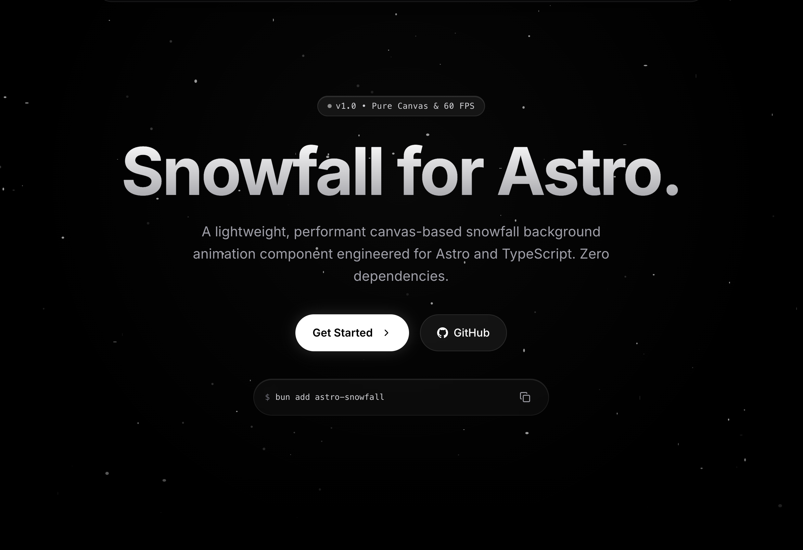

# astro-snowfall

A lightweight, performant canvas-based snowfall background animation component engineered for Astro and TypeScript. Zero dependencies.



## Features

- **Zero Runtime Dependencies** — Built with pure HTML5 Canvas and TypeScript. No bulky external animation libraries.
- **Hardware-Accelerated Performance** — 60 FPS animation loop with `requestAnimationFrame` and automatic offscreen pausing via `IntersectionObserver`.
- **Responsive & Retina Ready** — Automatically adapts to container dimensions and displays razor-sharp particles using `ResizeObserver`.
- **3D Tumbling Physics** — Multi-axis perspective rotation matrices simulating natural crystal tumbling motion.
- **Astro Native** — Seamlessly integrates with Astro Islands, SSG/SSR, and ClientRouter View Transitions.
- **Strictly Typed** — Exported TypeScript definitions with complete IDE auto-completion.

---

## Installation

### Package Manager

Install with your preferred package manager:

```bash
# bun (recommended)
bun add astro-snowfall

# pnpm
pnpm add astro-snowfall

# npm
npm install astro-snowfall

# yarn
yarn add astro-snowfall
```

### Shadcn CLI

Add directly to your components via the shadcn registry:

```bash
npx shadcn@latest add https://fermeridamagni.github.io/astro-snowfall/r/snowfall.json
```

### Manual Installation

Alternatively, copy the source files directly into your project:

```bash
cp -r src/lib/snowfall your-project/src/lib/
cp src/components/Snowfall.astro your-project/src/components/
```

---

## Usage

### 1. Container-Bound Snowfall

Drop `<Snowfall />` inside any relative container. The canvas automatically sizes to fit the container bounds:

```astro
---
import Snowfall from "astro-snowfall";
---

<div class="relative w-full h-80 rounded-2xl overflow-hidden bg-black">
  <Snowfall snowflakeCount={60} speed={[0.8, 1.8]} />

  <div class="relative z-10 flex h-full items-center justify-center">
    <h1 class="text-2xl font-bold text-white">Winter Showcase</h1>
  </div>
</div>
```

### 2. Fullscreen Background

Fix the canvas across your layout so snow gently falls as visitors scroll through pages:

```astro
---
import Snowfall from "astro-snowfall";
---

<html lang="en">
  <body class="bg-black text-white">
    <!-- Non-interfering fixed background -->
    <div class="fixed inset-0 z-0 pointer-events-none">
      <Snowfall 
        color="#ffffff"
        snowflakeCount={100}
        speed={[0.5, 2.0]}
        wind={[-0.3, 0.6]}
      />
    </div>

    <main class="relative z-10">
      <slot />
    </main>
  </body>
</html>
```

---

## Props Reference

All properties are optional and provide sensible defaults out of the box.

| Prop | Type | Default | Description |
| :--- | :--- | :--- | :--- |
| `color` | `string` | `'#dee4fd'` | Color of snowflakes. Any valid CSS color value (hex, rgb, hsl). |
| `snowflakeCount` | `number` | `150` | Total number of snowflake particles simultaneously rendered. |
| `radius` | `[number, number]` | `[0.5, 3.0]` | Minimum and maximum snowflake radius in pixels. |
| `speed` | `[number, number]` | `[1.0, 3.0]` | Vertical falling speed range in pixels per frame. |
| `wind` | `[number, number]` | `[-0.5, 2.0]` | Horizontal drift velocity range (negative = left, positive = right). |
| `opacity` | `[number, number]` | `[1.0, 1.0]` | Randomized particle opacity interval (0.0 to 1.0). |
| `enable3DRotation` | `boolean` | `false` | Enables pseudo-3D perspective tumbling rotation around axes. |
| `rotationSpeed` | `[number, number]` | `[-1.0, 1.0]` | Tumbling angular velocity in degrees per frame (requires 3D enabled). |
| `changeFrequency` | `number` | `200` | Frames between wind fluctuation updates for natural turbulence. |
| `images` | `CanvasImageSource[]` | `undefined` | Optional array of images or SVGs to render instead of circles. |
| `class` | `string` | `undefined` | Optional CSS classes applied directly to the canvas element. |
| `style` | `string` | `undefined` | Optional inline styles applied directly to the canvas element. |

---

## Presets

### Gentle Flurry
Quiet, delicate snowfall with soft drift and varied transparency:

```astro
<Snowfall
  color="#ffffff"
  snowflakeCount={45}
  speed={[0.5, 1.5]}
  wind={[-0.4, 0.4]}
  radius={[0.6, 2.0]}
  opacity={[0.3, 0.8]}
/>
```

### Mountain Blizzard
Dense, rapid snowfall with strong directional crosswind:

```astro
<Snowfall
  color="#e4e4e7"
  snowflakeCount={110}
  speed={[3.5, 7.5]}
  wind={[-2.5, 1.5]}
  radius={[0.5, 2.5]}
/>
```

### Tumbling Crystals (3D Rotation)
Multi-axis tumbling crystals simulating spatial orientation:

```astro
<Snowfall
  color="#ffffff"
  snowflakeCount={65}
  speed={[1.2, 2.8]}
  enable3DRotation={true}
  rotationSpeed={[-3.0, 3.0]}
/>
```

---

## Architecture & Performance

- **IntersectionObserver Lifecycle**: Automatically halts animation loop when the canvas is scrolled out of view or the browser tab is hidden, conserving mobile CPU and GPU resources.
- **ResizeObserver Precision**: Synchronizes canvas pixel resolution dynamically with parent container bounds to maintain crisp rendering without layout shift.
- **Batch Path Drawing**: When 3D rotation is disabled, particles are rendered in a single continuous `beginPath()` operation, minimizing canvas draw calls.
- **Frame-Independent Physics**: Updates positions based on elapsed frame deltas, ensuring consistent movement velocity across 60 Hz, 120 Hz, and variable refresh rate screens.

---

## Project Structure

```txt
astro-snowfall/
├── public/
│   └── r/
│       ├── registry.json           # Shadcn registry metadata
│       └── snowfall.json           # Distribution component manifest
├── src/
│   ├── components/
│   │   ├── Snowfall.astro          # Core Astro component
│   │   ├── icons/                  # Vector icons
│   │   ├── sections/               # Showcase landing sections
│   │   └── ui/                     # UI primitives (Card, Button, CodeBlock)
│   ├── lib/
│   │   └── snowfall/
│   │       ├── config.ts           # Default configurations
│   │       ├── index.ts            # Library barrel export
│   │       ├── snowflake.ts        # Particle physics and geometry
│   │       ├── snowfall-canvas.ts  # RAF canvas lifecycle controller
│   │       ├── types.ts            # TypeScript interfaces
│   │       └── utils.ts            # Math, interpolation, and helpers
│   ├── pages/
│   │   └── index.astro             # Documentation and showcase page
│   ├── scripts/
│   │   └── animations.ts           # GSAP scroll animation controller
│   └── styles/
│       └── global.css              # Monochromatic design system & tokens
├── astro.config.ts
├── biome.jsonc
└── package.json
```

---

## Development

```bash
# Install dependencies
bun install

# Start local dev server
bun run dev

# Format and lint code with Ultracite
bun run fix
bun run check

# Build production showcase site
bun run build
```

---

## Credits

Engineered by [@fermeridamagni](https://github.com/fermeridamagni). Based on the canvas concepts originally introduced in `react-snowfall` by Cahil Foley, adapted and redesigned for the Astro ecosystem with native TypeScript, 3D tumbling rotation, and zero runtime dependencies.

## License

[MIT](LICENSE)
